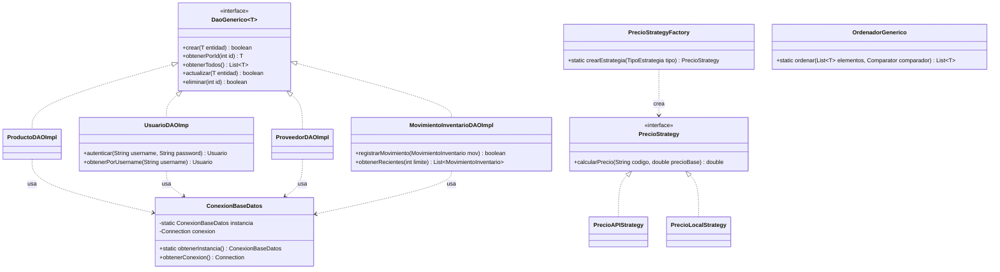

# Documentación — Sistema de Inventarios

## 1. Control de versiones

El proyecto usa Git y GitHub. La rama principal actual es `main` y el
repositorio conserva ramas de trabajo como `develop`, `feature/login`,
`feature/dao-login`, `feature/database-connection`, `feature/main-menu` y
`feature/mvc-architecture`.

Los commits siguen mensajes convencionales cuando aplica:

- `feat`: funcionalidad nueva.
- `fix`: corrección de un error.
- `refactor`: cambio estructural sin modificar el objetivo de la función.
- `docs`: documentación.
- `chore`: tareas de mantenimiento.

## 2. Autenticación y seguridad

### Inicio de sesión basado en base de datos

La tabla `usuarios` almacena el nombre completo, `username`, hash de
contraseña, rol y estado activo. `LoginController` recibe el usuario y la
contraseña desde la vista, valida que no estén vacíos y delega la consulta a
`UsuarioDAOImp`.

El acceso solo se concede si existe un usuario con el `username`, contraseña y
estado activo correspondientes.

### Registro de cuentas y recuperación de contraseña

Desde `Login.fxml` se accede a la ventana modal `Cuenta.fxml` (`CuentaController`),
que permite:

- **Crear cuenta:** valida campos obligatorios, longitud mínima de contraseña,
  confirmación y unicidad de `username` mediante `UsuarioDAOImp.obtenerPorUsername()`.
  Las cuentas auto-registradas se crean activas con rol `OPERADOR` y contraseña
  cifrada en SHA-1.
- **Recuperar contraseña:** verifica que el `username` y el `nombreCompleto`
  coincidan con un registro existente antes de actualizar el nuevo hash SHA-1
  mediante `UsuarioDAOImp.actualizar()`.

### Hash de contraseña

Clase: `com.cabrera.inventario.util.UtilidadSeguridad`

Proceso actual:

1. La persona escribe sus credenciales en `Login.fxml`.
2. `LoginController` calcula SHA-1 de la contraseña introducida.
3. `UsuarioDAOImp` compara ese resultado con `usuarios.password`.
4. Si los datos coinciden, se abre el menú principal.

> SHA-1 se mantiene porque es el mecanismo actual del proyecto y del dato
> inicial. Para una versión real debe sustituirse por BCrypt o Argon2.

El sistema actual no usa JWT ni tokens persistentes. El rol `ADMIN` puede
gestionar el catálogo, proveedores e importaciones; el rol `OPERADOR` y los
demás perfiles pueden consultar el inventario, visualizar el Dashboard,
exportar datos y registrar movimientos.

## 3. Patrones de diseño implementados

### 3.1 Strategy Pattern

Ubicación: `strategies/`

Interfaz: `PrecioStrategy`

Implementaciones:

1. `PrecioLocalStrategy`: aplica un multiplicador local de 1.16 al precio base.
2. `PrecioAPIStrategy`: consulta FakeStoreAPI y usa el precio recibido como una
   sugerencia; si la consulta falla, conserva el precio base.

`NuevoProductoController` utiliza esta interfaz para calcular el precio sugerido
sin acoplarse a una regla específica de cálculo.

### 3.2 Data Access Object (DAO)

Ubicación: `dao/`

Interfaz genérica: `DaoGenerico<T>`

Define operaciones comunes:

- `crear(T entidad)`
- `obtenerPorId(int id)`
- `obtenerTodos()`
- `actualizar(T entidad)`
- `eliminar(int id)`

Implementaciones activas:

- `ProductoDAOImpl`: consulta y administra productos; el stock solo se modifica
  mediante movimientos.
- `ProveedorDAOImpl`: administra proveedores.
- `UsuarioDAOImp`: autentica, consulta, registra y actualiza usuarios.
- `MovimientoInventarioDAOImpl`: registra movimientos y actualiza stock dentro
  de la misma transacción JDBC.

Existen interfaces y DAOs para categorías, clientes, compras, ventas y detalles.

### 3.3 Singleton Pattern

Ubicación: `util/ConexionBaseDatos.java`

`ConexionBaseDatos` conserva una única instancia de conexión JDBC a MySQL.
Carga la configuración desde `database.properties` y la expone a los DAO.

### 3.4 Factory Method Pattern

Ubicación: `factories/PrecioStrategyFactory.java`

`PrecioStrategyFactory` encapsula la creación de las estrategias de cálculo de
precios (`PrecioAPIStrategy` y `PrecioLocalStrategy`) a partir del enum
`TipoEstrategia`. Desacopla a `NuevoProductoController` de las clases concretas
y centraliza la instanciación de nuevas estrategias.

## 4. Programación genérica

`DaoGenerico<T>` usa el parámetro `T` para describir el tipo de entidad que
administra cada DAO. `OrdenadorGenerico.ordenar(List<T>, Comparator<? super T>)`
ordena copias de listas sin modificar la lista original. El inventario usa este
ordenador para mostrar productos por nombre.

## 5. Arquitectura MVC con JavaFX

El proyecto sigue MVC para una aplicación de escritorio. No utiliza Spring Boot
ni endpoints REST.

### Modelo

Ubicación: `models/`

Representa las entidades del dominio:

- `Usuario`, `Producto`, `Proveedor`, `Categoria` y `Cliente`.
- `Compra` y `DetalleCompra`.
- `Venta` y `DetalleVenta`.
- `MovimientoInventario`.

Los modelos de detalle usan una clave compuesta lógica formada por la operación
y el producto: `(id_compra, id_producto)` o `(id_venta, id_producto)`.
`getSubtotal()` calcula el importe desde cantidad y precio unitario; no guarda
un valor duplicado.

### Vista

Ubicación: `src/main/java/com/cabrera/inventario/views/`

Vistas disponibles:

- `Login.fxml`: acceso al sistema y enlaces de gestión de cuenta.
- `Cuenta.fxml`: registro de nuevos usuarios y restablecimiento de contraseña.
- `MenuPrincipal.fxml`: tabla del inventario y navegación principal.
- `Dashboard.fxml`: indicadores KPI y gráficas estadísticas del inventario.
- `NuevoProducto.fxml`: alta de productos.
- `EditarProducto.fxml`: actualización de producto seleccionado.
- `Proveedores.fxml`: mantenimiento de proveedores.
- `Movimientos.fxml`: captura de entradas/salidas y reporte reciente.

### Controlador

Ubicación: `controllers/`

- `LoginController`: valida acceso, abre la gestión de cuentas y navega al menú principal.
- `CuentaController`: gestiona el alta de usuarios y la recuperación de contraseñas.
- `MenuPrincipalController`: carga productos, abre ventanas de alta, edición,
  proveedores, movimientos y Dashboard; también elimina productos y cierra sesión.
- `DashboardController`: calcula KPIs y alimenta las gráficas (`PieChart` y `BarChart`).
- `NuevoProductoController`: valida y registra productos; obtiene la estrategia de
  precio sugerido mediante `PrecioStrategyFactory`.
- `EditarProductoController`: actualiza los datos del producto y valida
  precios no negativos.
- `ProveedoresController`: crea, modifica, lista y elimina proveedores.
- `MovimientoController`: registra movimientos del usuario activo y muestra los
  últimos 100 movimientos.

### Flujo principal

```text
Vista FXML → Controller → Factory / Strategy / DAO → JDBC → MySQL
```

### Diagrama de Clases UML (Patrones y Persistencia)



## 6. Funcionalidades

### 6.1 Autenticación y gestión de cuentas

- Inicio de sesión con usuario activo almacenado en MySQL.
- Registro de nuevas cuentas con rol `OPERADOR` y validación de duplicados.
- Recuperación de contraseña mediante verificación de identidad y actualización en SHA-1.
- Validación de campos vacíos.
- Cierre de sesión que vuelve a la pantalla de acceso.
- Salida completa de JavaFX.

### 6.2 Gestión de productos

- Listado de código, nombre, descripción, precio de venta y stock.
- Registro de productos.
- Validación de campos obligatorios, duplicados y stock negativo.
- Consulta opcional de un precio sugerido.
- Edición de nombre, descripción y precios.
- Eliminación con confirmación.

El stock no se edita desde los formularios de alta o edición. Un producto nuevo
inicia con cero existencias y las cantidades se ajustan mediante movimientos.
`ProductoDAOImpl.actualizar` tampoco modifica la columna de stock.

### 6.3 Movimientos y reportes de inventario

- Registro de movimientos `ENTRADA` y `SALIDA` con cantidad positiva y motivo.
- Cada movimiento queda vinculado al usuario que inició sesión.
- Los usuarios con movimientos registrados no se pueden eliminar, para
  conservar el responsable del historial.
- El cambio de stock y el registro de auditoría se confirman juntos dentro de
  una transacción; si falla cualquiera, se revierte la operación.
- Las salidas que dejarían el stock por debajo de cero se rechazan.
- El reporte presenta fecha, producto, tipo, cantidad, motivo y responsable para
  los 100 movimientos más recientes.
- El menú muestra una alerta cuando existen productos con cinco unidades o
  menos; el umbral está definido por `UMBRAL_STOCK_BAJO`.
- El rol `ADMIN` controla las acciones de alta, edición y eliminación de
  productos, proveedores e importación.
- El campo de búsqueda acepta lectores de código de barras configurados como
  teclado (keyboard wedge): escanea el código para localizar y seleccionar el
  producto.

### 6.4 Importación y exportación

- El menú permite exportar e importar el catálogo en CSV o JSON.
- El CSV usa los encabezados `codigo,nombre,descripcion,precioCompra,precioVenta,stockActual`.
- El JSON usa un arreglo de objetos con esas mismas propiedades.
- La importación valida los registros antes de guardarlos y actualiza productos
  existentes por código.
- Cada diferencia de stock importada queda registrada como entrada o salida,
  con el usuario actual como responsable.

### 6.5 Gestión de proveedores

- Listado, alta, edición y eliminación de proveedores.
- Datos de contacto: teléfono, correo y dirección.
- Estado activo/inactivo.

### 6.6 Dashboard e indicadores de desempeño

- Tarjetas KPI en tiempo real: total de productos registrados, unidades totales
  en existencia, valor monetario del inventario y conteo de alertas de stock bajo.
- Gráfica circular (`PieChart`) con la distribución del catálogo por estado de
  existencias (Stock Óptimo, Stock Bajo y Agotado).
- Gráfica de barras (`BarChart`) que compara el volumen total de unidades en
  movimientos de `ENTRADA` frente a `SALIDA`.

### 6.7 Funcionalidades aún no implementadas en la interfaz

- CRUD de categorías y clientes.
- Registro de compras y ventas con actualización automática del stock.
- Integración con lectores que requieran SDK, cámara o conexión directa; el
  campo actual funciona con lectores que envían el código como texto.

## 7. Base de datos

### Motor

MySQL mediante Docker, o MySQL compatible instalado localmente.

### Tablas Principales

| Tabla | Responsabilidad |
| --- | --- |
| `usuarios` | Credenciales, rol y estado de acceso. |
| `categorias` | Clasificación de productos. |
| `proveedores` | Datos de los proveedores. |
| `clientes` | Datos de los clientes. |
| `productos` | Catálogo, precios de referencia y stock actual. |
| `compras` | Encabezado de compras a proveedor. |
| `detalle_compras` | Productos, cantidad y costo histórico de cada compra. |
| `ventas` | Encabezado de ventas a cliente. |
| `detalle_ventas` | Productos, cantidad y precio histórico de cada venta. |
| `movimientos` | Historial de entradas y salidas con responsable. |

### Nomenclatura de constraints

- `PK_`: clave primaria simple, por ejemplo `PK_productos`.
- `FK_`: clave foránea simple, por ejemplo `FK_productos_categoria`.
- `PK2_`: clave primaria compuesta, por ejemplo `PK2_detalle_ventas`.
- `FK2_`: clave foránea de una tabla con clave compuesta, por ejemplo
  `FK2_detalle_ventas_producto`.
- `UQ_`: valor único, por ejemplo `UQ_productos_codigo`.
- `CK_` y `CK2_`: reglas de validación, como stock no negativo y cantidad
  mayor que cero.

### Scripts

- `database_script.sql`: crea una base nueva ya normalizada.
- `database_migration_normalizacion.sql`: transforma el esquema anterior;
  requiere respaldo porque elimina la tabla redundante `detalleproductos`.

## 8. Configuración y ejecución

### Variables de entorno para MySQL con Docker

Archivo `.env`:

```properties
MYSQL_DATABASE=sistema_inventarios
MYSQL_USER=inventarios_app
MYSQL_PASSWORD=contraseña
MYSQL_ROOT_PASSWORD=cambia_esta_clave_root
MYSQL_PORT=3307
```

### Conexión de la aplicación

Archivo no versionado: `src/main/resources/database.properties`

```properties
db.url=jdbc:mysql://localhost:3307/sistema_inventarios?useSSL=false&allowPublicKeyRetrieval=true&serverTimezone=America/Mexico_City
db.user=inventarios_app
db.password=contraseña
```

### Credenciales iniciales

```text
Usuario: admin
Contraseña: admin123
```

### Iniciar la base de datos

```powershell
docker compose up -d
docker compose ps
```

### Compilar y ejecutar

```powershell
./mvnw.cmd compile
./mvnw.cmd javafx:run
```

Se necesita un JDK compatible con Java 21. El archivo `pom.xml` configura el
compilador, JavaFX, MySQL Connector/J y JSON.

## 9. Verificación actual

La compilación y las pruebas unitarias se validan con:

```powershell
./mvnw.cmd clean test
```

La verificación completa contra MySQL requiere tener Docker Desktop o un
servidor MySQL en ejecución. Después de crear una base nueva se recomienda
probar login, registro y recuperación de cuentas, CRUD de productos y proveedores,
entradas, salidas, rechazo de stock insuficiente, Dashboard con gráficas, reporte
de movimientos e importación/exportación CSV y JSON.

## 10. Más implementaciones que se podrían mejorar

1. Implementar categorías y clientes en interfaz y DAO.
2. Implementar compras, ventas y detalles usando transacciones y registrar un
   movimiento por cada compra o venta.
3. Sustituir SHA-1 por BCrypt o Argon2.
4. Usar `BigDecimal` para importes monetarios.
5. Agregar pruebas de integración de los DAO contra MySQL.

# API usada para el ejemplo
- API disponible en: https://fakestoreapi.com